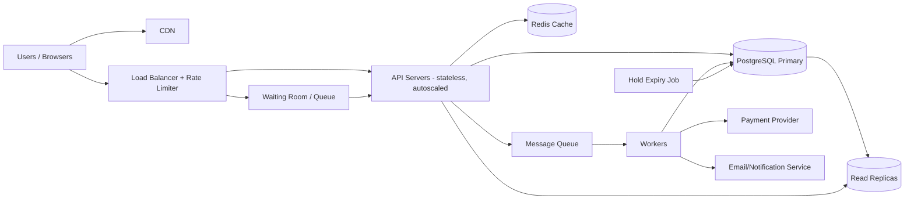

# TicketHub: System Design Document

TicketHub is a website that sells tickets for concerts and events. This document follows the six-part design framework: requirements, estimates, API, data model, architecture, and trade-offs.

---

## 1. Requirements

### Functional requirements

- Users can register, log in, and manage their account.
- Users can browse and search upcoming events (by name, artist, city, date).
- Users can view an event's seat map and see which seats are available.
- Users can select seats and **hold** them temporarily (5 minutes) while they pay.
- Users can pay for held seats and receive confirmed tickets.
- Users can view their purchased tickets (and order history).
- Held seats that are not paid for are released automatically.

### Non-functional requirements

| Quality          | Requirement                                                                                                                                                                                                                                               |
| ---------------- | --------------------------------------------------------------------------------------------------------------------------------------------------------------------------------------------------------------------------------------------------------- |
| **Speed**        | Browsing pages respond in < 300 ms (p95). Seat map loads in < 500 ms. Holding a seat responds in < 1 s, even during a big sale.                                                                                                                           |
| **Correctness**  | A seat is **never** sold to two people. A user is never charged without receiving a ticket, and never receives a ticket without being charged. Payments are idempotent (a retried request does not charge twice).                                         |
| **Fairness**     | During a big sale, access is first-come-first-served. Users in a waiting room are admitted in the order they arrived. Per-user rate limits and bot protection stop one person from grabbing most of the seats. A single order is capped (e.g. 6 tickets). |
| **Availability** | Browsing stays up even if the purchase flow is overloaded (target 99.9%).                                                                                                                                                                                 |
| **Durability**   | Confirmed orders are never lost (replicated database, backups).                                                                                                                                                                                           |
| **Scalability**  | The system handles about 500x normal traffic for short bursts (see estimates).                                                                                                                                                                            |
| **Security**     | Passwords are hashed, traffic uses HTTPS, card data is handled by a third-party payment provider (TicketHub never stores card numbers).                                                                                                                   |

---

## 2. Estimates

### Given facts

- 2,000,000 registered users
- Normal day: 50,000 visitors, 10 page views each, 5,000 tickets sold
- Big sale: 200,000 people try to buy 20,000 seats in the first 10 minutes

### Normal traffic

- Page views: 50,000 × 10 = **500,000 per day**
- Average rate: 500,000 / 86,400 s ≈ **6 requests/second**
- Daytime peak (assume 10x the average): ≈ **60 requests/second**
- Ticket sales: 5,000 / 86,400 ≈ **0.06 purchases/second** (about 1 every 17 seconds)
- Data growth: 5,000 tickets/day × 365 ≈ 1.8 million tickets per year. At about 1 KB per ticket row, that is under 2 GB/year, which is tiny. Storage is not a problem.

### Big sale peak

- 200,000 users in 10 minutes (600 s) ≈ **333 new users/second** arriving
- Each user makes roughly 10 requests (open event, load seat map, refresh the map a few times, hold, pay, view tickets): 200,000 × 10 = 2,000,000 requests in 600 s ≈ **3,300 requests/second**. Allowing for refresh spikes in the first seconds, plan for **5,000 requests/second**.
- Hold attempts: if each user tries about 2–3 times, that is about 500,000 attempts in 600 s ≈ **800 hold attempts/second**, concentrated on the same 20,000 rows.
- Sales: 20,000 tickets in 10 minutes ≈ **33 purchases/second**.
- Contention: 200,000 people compete for 20,000 seats, so **10 people per seat**. 90% of users will lose.

### Comparison

| Metric                      | Normal day    | Big sale (first 10 min) | Ratio        |
| --------------------------- | ------------- | ----------------------- | ------------ |
| Requests/second             | ~6 (peak ~60) | ~3,300–5,000            | **~50–800x** |
| Purchases/second            | 0.06          | 33                      | **~500x**    |
| Contention on a single seat | almost none   | ~10 buyers per seat     | n/a          |

**Conclusion:** The big sale is not just "more traffic." It is a short burst roughly 500x bigger than normal, with heavy contention on the same rows. Normal traffic could run on one small server and one database. The big sale needs caching, a queue/waiting room, and careful concurrency control. Because the burst lasts only minutes, we should absorb it with a waiting room and autoscaling rather than permanently over-provisioning.

---

## 3. API Design

REST over HTTPS, JSON bodies. All endpoints except browsing require an auth token.

| #   | Method & Path                             | Purpose                                               |
| --- | ----------------------------------------- | ----------------------------------------------------- |
| 1   | `GET /events?city=&date=&q=&page=`        | Browse/search events                                  |
| 2   | `GET /events/{eventId}`                   | Event details                                         |
| 3   | `GET /events/{eventId}/seats?section=`    | View seats and their status (available / held / sold) |
| 4   | `POST /events/{eventId}/holds`            | Hold seats for 5 minutes                              |
| 5   | `DELETE /holds/{holdId}`                  | Release held seats early                              |
| 6   | `POST /orders`                            | Pay for held seats (creates order)                    |
| 7   | `GET /orders/{orderId}`                   | Check order/payment status                            |
| 8   | `GET /me/tickets`                         | View my tickets                                       |
| 9   | `POST /auth/login`, `POST /auth/register` | Authentication                                        |

### Key request/response examples

**Hold seats** `POST /events/42/holds`

```json
{ "seatIds": [1101, 1102] }
```

Response `201 Created`:

```json
{
  "holdId": "h_8f3a",
  "seatIds": [1101, 1102],
  "expiresAt": "2026-11-01T19:05:00Z"
}
```

If any seat is already taken: `409 Conflict` with `{ "error": "SEAT_UNAVAILABLE", "unavailableSeatIds": [1102] }`. Nothing is held (all or nothing).

**Pay** `POST /orders`

```json
{ "holdId": "h_8f3a", "paymentToken": "tok_abc" }
```

Headers: `Idempotency-Key: 7c1e...` (a retry with the same key returns the same result and never charges twice).
Response `201 Created`: `{ "orderId": "o_991", "status": "PAID", "ticketIds": [...] }`.
Errors: `410 Gone` if the hold expired, `402 Payment Required` if payment failed.

**View tickets** `GET /me/tickets` returns a list of tickets with event, seat, and a QR code value.

---

## 4. Data Model

Relational database (PostgreSQL), because we need transactions and constraints for correctness.

```
users 1 ──< orders 1 ──< tickets >── 1 seats >── 1 events
                │
                └──< payments
users 1 ──< holds 1 ──< seats (held_by_hold_id)
```

### Tables

**users**
| Column | Type | Notes |
|---|---|---|
| id | BIGINT PK | |
| email | TEXT UNIQUE NOT NULL | |
| password_hash | TEXT NOT NULL | |
| created_at | TIMESTAMPTZ | |

**events**
| Column | Type | Notes |
|---|---|---|
| id | BIGINT PK | |
| name | TEXT NOT NULL | |
| venue | TEXT | |
| city | TEXT | indexed |
| starts_at | TIMESTAMPTZ | indexed |
| on_sale_at | TIMESTAMPTZ | when tickets go on sale |
| total_seats | INT | |

**seats** (one row per physical seat _per event_)
| Column | Type | Notes |
|---|---|---|
| id | BIGINT PK | |
| event_id | BIGINT FK → events | |
| section, row_label, seat_number | TEXT/INT | |
| price_cents | INT | |
| status | TEXT CHECK IN ('available','held','sold') | |
| hold_id | BIGINT FK → holds, NULL | who holds it |
| hold_expires_at | TIMESTAMPTZ NULL | |
| | **UNIQUE (event_id, section, row_label, seat_number)** | a seat exists once per event |

**holds**
| Column | Type | Notes |
|---|---|---|
| id | BIGINT PK | |
| user_id | BIGINT FK → users | |
| event_id | BIGINT FK → events | |
| expires_at | TIMESTAMPTZ | |

**orders**
| Column | Type | Notes |
|---|---|---|
| id | BIGINT PK | |
| user_id | BIGINT FK → users | |
| event_id | BIGINT FK → events | |
| status | TEXT | PENDING / PAID / FAILED |
| total_cents | INT | |
| idempotency_key | TEXT UNIQUE | prevents double charge |
| created_at | TIMESTAMPTZ | |

**tickets**
| Column | Type | Notes |
|---|---|---|
| id | BIGINT PK | |
| order_id | BIGINT FK → orders | |
| seat_id | BIGINT FK → seats | **UNIQUE** |
| qr_code | TEXT | |

**payments**
| Column | Type | Notes |
|---|---|---|
| id | BIGINT PK | |
| order_id | BIGINT FK → orders | |
| provider_ref | TEXT UNIQUE | id from payment provider |
| amount_cents | INT | |
| status | TEXT | |

### Relationships

- A user has many orders, holds, and (through orders) tickets.
- An event has many seats.
- An order has many tickets; each ticket is for exactly one seat.
- A seat can appear in **at most one** ticket (enforced by `UNIQUE(seat_id)` on `tickets`).

---

## 5. Preventing Double-Booking (Two People, One Seat)

This is the most important correctness rule. We use **three layers**, and the database is the final judge.

### Layer 1: Atomic conditional update (the hold)

Instead of "read the seat, check it is free, then write" (which has a race condition: two users can both read "available"), we do the check and the write in **one atomic SQL statement**:

```sql
UPDATE seats
SET status = 'held', hold_id = :holdId, hold_expires_at = now() + interval '5 minutes'
WHERE id = :seatId
  AND ( status = 'available'
        OR (status = 'held' AND hold_expires_at < now()) );
```

The database locks the row while updating, so if two users run this at the same moment, one runs first and gets `1 row affected`. The second then sees `status = 'held'`, matches `0 rows`, and receives `409 Conflict`. The whole hold request runs inside **one transaction** covering all requested seats: if any seat returns 0 rows, we roll back so the user never ends up with half of what they asked for. Seats are always locked in sorted order of id, which avoids deadlocks between two users who select overlapping seats.

### Layer 2: Transaction at payment time

When the user pays, one transaction does:

1. Verify the hold still belongs to this user and has not expired (`SELECT ... FOR UPDATE` on the seat rows).
2. Create the order and tickets.
3. Mark seats `sold`.
4. Commit only if all steps succeed.

If the hold expired and someone else took the seat, step 1 fails and the user is not charged (we charge via the provider only after the seats are confirmed as still held, and refund automatically if the final commit fails).

### Layer 3: Constraint as a safety net

Even if there were a bug in the application code, `tickets.seat_id` has a **UNIQUE constraint**. A second ticket for the same seat is rejected by the database itself, with a constraint violation error, and the transaction rolls back. The rule "one seat, one ticket" cannot be broken by any code path.

### Supporting details

- **Idempotency:** `orders.idempotency_key` is UNIQUE, so a double click or network retry cannot create two orders or two charges.
- **Hold expiry:** A background job (every 30 seconds) resets expired holds to `available`. The `OR (held AND expired)` clause in the hold query also makes expiry correct even if the job is late.
- **Redis is not the source of truth.** Redis may be used to speed up the seat map and as a fast "reject early" check, but the PostgreSQL write decides who wins.

---

## 6. Architecture



```
Users ─► CDN (static files, images)
  │
  ▼
Load Balancer + Rate Limiter ─► Waiting Room (big sales only)
  │                                   │
  ▼                                   ▼
API Servers (stateless, autoscaled) ◄─┘
  │        │            │
  │        │            └─► Message Queue ─► Workers ─► Payment Provider / Email
  │        ▼
  │     Redis (cache: event pages, seat map snapshots, queue positions)
  ▼
PostgreSQL Primary (holds, orders, tickets) ──► Read Replicas (browsing/search)
```

### Components

- **CDN:** Serves images, JavaScript, and CSS, and can cache public event pages. Takes most of the browsing load off our servers.
- **Load balancer + rate limiter:** Spreads requests across API servers and limits requests per user/IP. Protects against bots and one user flooding the system (fairness).
- **Waiting room / queue:** For big sales, users enter a virtual queue and are admitted at a fixed rate (e.g. 500 people per minute) that the purchase path can handle. People are admitted in arrival order (fairness) and see their position. This turns a spike of 200,000 simultaneous users into a steady flow.
- **API servers:** Stateless services that implement the endpoints. Because they are stateless, we can add more in minutes when a sale starts.
- **Redis cache:** Stores event details and a short-lived (1–2 second) snapshot of the seat map, so thousands of people refreshing the seat map do not each hit the database. Also stores waiting-room positions and rate-limit counters.
- **PostgreSQL primary:** The single source of truth for seats, holds, orders, and tickets. All writes go here, which gives us transactions and constraints.
- **Read replicas:** Serve browsing and search queries, keeping the primary free for writes.
- **Message queue + workers:** Slow work (calling the payment provider, sending confirmation emails, generating QR codes) happens asynchronously, so API requests stay fast and a slow payment provider cannot back up the whole system.
- **Payment provider (third party):** Handles card data and charges; we only store a reference.
- **Hold expiry job:** Periodically releases expired holds.

### How it survives the big sale

1. **Static content and event pages come from the CDN/cache**, so most of the 3,300–5,000 req/s never reaches the database.
2. **The waiting room limits writes** to what the database can safely handle (~800 hold attempts/s is easy for PostgreSQL on indexed single-row updates, and the queue lowers it further).
3. **Seat map reads come from Redis snapshots** (1–2 s stale), and the final authority is the atomic `UPDATE`, so a stale map can cause a "seat just taken" message but never a double sale.
4. **API servers autoscale** (or are pre-scaled before the announced on-sale time, since we know when it starts).
5. **Payments are async and idempotent**, so slowness or retries do not block seat holding.
6. **Browsing is isolated** from purchasing (replicas + cache), so people not buying can still use the site.
7. **Short holds (5 minutes)** return abandoned seats to the pool quickly.

---

## 7. Trade-offs

### Trade-off 1: Waiting room (fairness and stability) vs. user experience

**Choice:** Use a virtual waiting room that admits people at a controlled rate.
**Benefit:** The database is never overwhelmed, and people get first-come-first-served treatment.
**Cost:** Users wait, and some may find it frustrating or give up. It adds a component to build and maintain. We accept this because a crashed site is worse for everyone than an orderly line.

### Trade-off 2: Strong consistency in PostgreSQL vs. speed of a distributed/NoSQL store

**Choice:** Keep seat state in a single PostgreSQL primary with transactions and constraints.
**Benefit:** Simple, provably correct protection against double-booking.
**Cost:** All seat writes go through one primary, which limits write scaling. At 20,000 seats and ~800 writes/s this is well within capacity, and if we needed more we could shard by `event_id`, since events do not share seats. We trade some theoretical scalability for correctness, which matters more when money is involved.

### Trade-off 3: Cached (slightly stale) seat map vs. always-fresh

**Choice:** Serve the seat map from a 1–2 second Redis snapshot.
**Benefit:** Huge reduction in database load.
**Cost:** Users sometimes click a seat that was just taken and get a conflict message. This is acceptable because it is a minor annoyance, not a correctness problem, as the atomic update has the last word.

### Trade-off 4: Hold duration (5 minutes)

**Short holds** free seats quickly and are fairer to people still waiting, but can expire while someone is typing card details. **Long holds** are friendlier to buyers but let people (or bots) lock up seats without buying. We pick 5 minutes, with an optional one-time extension during payment.

### Trade-off 5: Hold-then-pay vs. pay-then-assign

Holding seats first gives a good experience (you know you have the seat), but adds complexity (expiry, cleanup). Paying first would be simpler but could charge people for seats that are already gone. We choose hold-then-pay.
